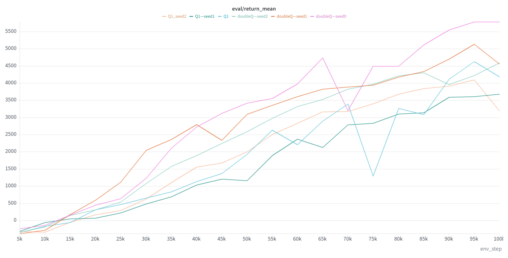
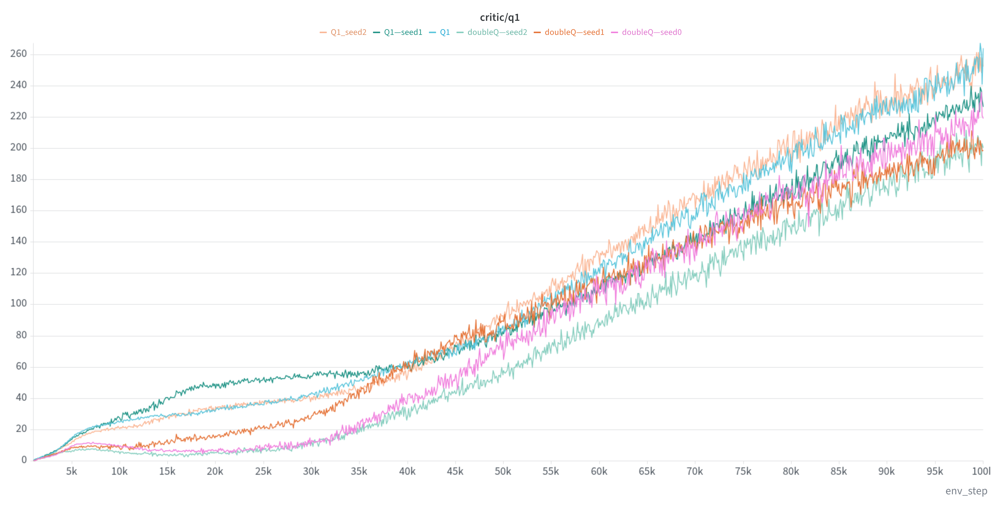
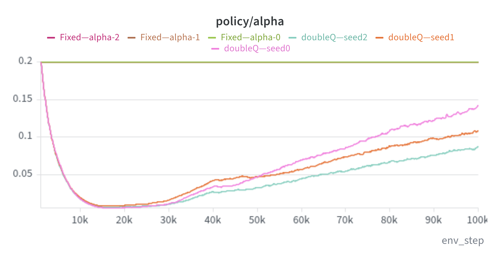

# Results

Experiments were run on `HalfCheetah-v5` for 100k environment steps with three training seeds.

Unless otherwise stated, all hyperparameters were kept unchanged between compared variants.

---

## 1. Single-Q vs Double-Q

Standard SAC uses two critics and takes the minimum value

\[
\min(Q_1,Q_2)
\]

when constructing the target and updating the actor.

To test the effect of this design, I compared the standard Double-Q version with a Single-Q version.

### Evaluation return

Double-Q performs better overall across the three seeds.

Single-Q can still learn, but its performance is less consistent and generally lower than the standard Double-Q implementation.

### Critic values

The Single-Q runs tend to produce larger Q-values than the Double-Q runs, especially later in training.

Interestingly, the higher critic values do not correspond to higher evaluation returns.

This is consistent with the motivation for clipped Double-Q learning: using a single critic makes optimistic value estimates more likely to affect the policy and the bootstrapped target.

This experiment does not directly measure Q-value bias against Monte-Carlo returns, so I treat this as evidence consistent with overestimation rather than a direct measurement of it.

### Takeaway

For this HalfCheetah experiment, the standard Double-Q design gives more reliable learning and better policy performance.

---

## 2. Fixed Alpha vs Automatic Alpha

SAC trades off reward maximization and policy entropy through the temperature parameter

\[
\alpha.
\]

I compared:

- fixed \(\alpha = 0.2\)
- automatically learned \(\alpha\), initialized at \(0.2\)

All other settings were kept the same.

For HalfCheetah, the action dimension is 6, so the target entropy is

\[
\mathcal H_{\text{target}} = -6.
\]

### Evaluation return

Automatic alpha gives more consistent learning across seeds.

All three automatic-alpha runs reach strong final performance, while the fixed-alpha runs show much larger variation.

Two fixed-alpha seeds eventually reach reasonable performance, but one run learns much more slowly and remains far below the other runs even at 100k steps.

The main difference is therefore not only final return, but also training robustness and sample efficiency.

### Alpha during training

For the fixed-alpha runs,

\[
\alpha = 0.2
\]

throughout training.

For automatic-alpha SAC, alpha changes substantially over time.

It starts from 0.2, quickly decreases during the early stage of training, reaches a very small value around 15k–20k steps, and then gradually increases again.

The final value also differs between seeds.

This shows that the entropy weight preferred by the policy is not constant during training.

### Policy entropy

This is the clearest difference between the two variants.

With automatic alpha, policy entropy quickly approaches approximately

\[
-6,
\]

and stays close to the target entropy for the rest of training.

With fixed \(\alpha=0.2\), entropy remains much higher and varies substantially between seeds.

The fixed value therefore applies too much entropy pressure for this setting and prevents the policy entropy from approaching the target value.

Automatic temperature tuning instead adjusts alpha according to the current policy and keeps entropy near the desired level.

### Takeaway

The main benefit of automatic alpha in this experiment is not simply that it finds a "better constant alpha".

Instead, alpha changes throughout training in order to regulate policy entropy.

The experiment shows the full feedback loop:

\[
\text{policy entropy}
\rightarrow
\alpha \text{ update}
\rightarrow
\text{entropy regularization strength}
\rightarrow
\text{policy entropy}.
\]

For HalfCheetah, automatic temperature tuning produces much more controlled entropy and more reliable training than keeping \(\alpha=0.2\) fixed.

---

## Current Summary

So far, the experiments support two important SAC design choices:

1. **Double-Q critics**

   Using two critics and the minimum estimate gives better learning behavior than the Single-Q variant and reduces the effect of optimistic critic estimates.

2. **Automatic temperature tuning**

   A fixed entropy coefficient does not maintain the desired policy entropy throughout training. Learning alpha automatically keeps the entropy near the target and improves robustness across seeds.

These experiments complete the main SAC ablations used in this project.

Next, I will investigate the effect of the update-to-data ratio before moving on to REDQ.