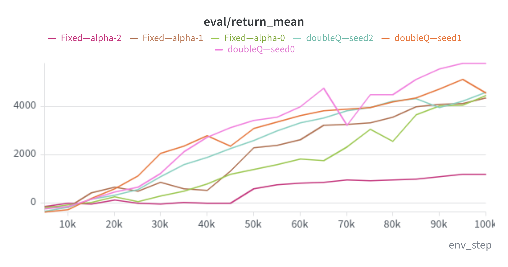
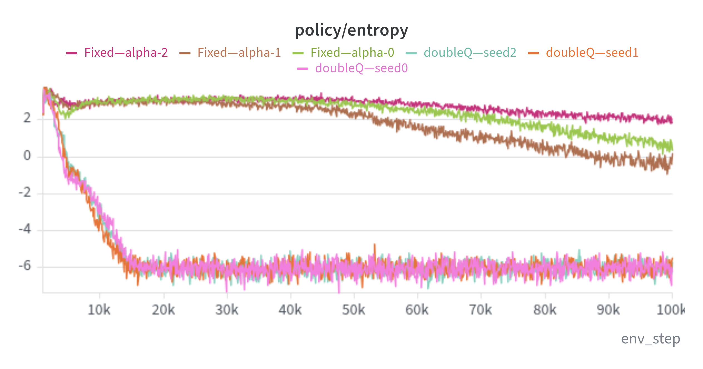
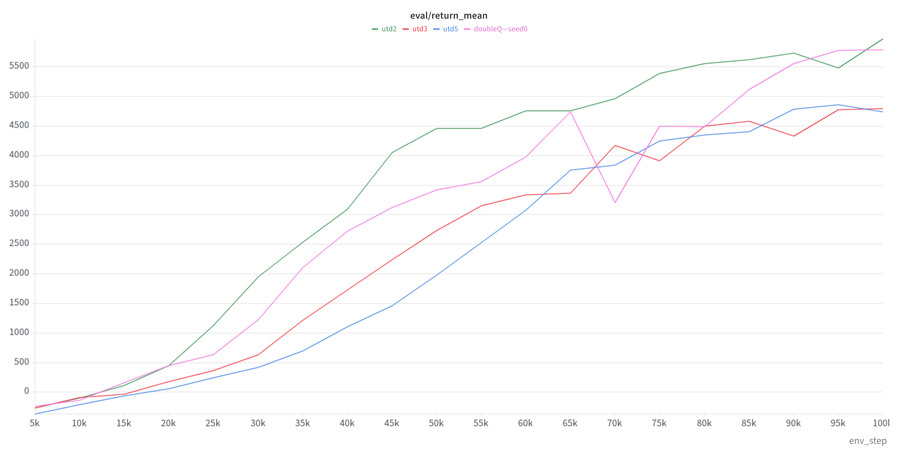
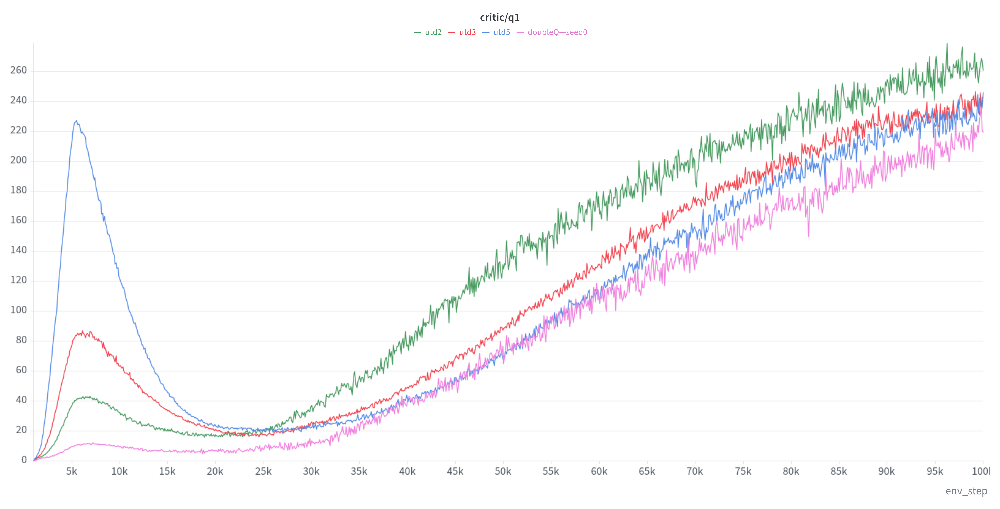
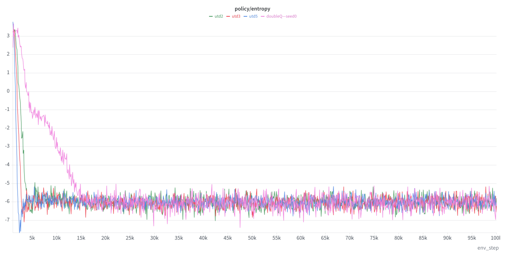

# Experimental Results

Experiments were run on `HalfCheetah-v5` for 100k environment steps.

Unless otherwise stated, all compared variants use the same network architecture and training hyperparameters.

---

## 1. Single-Q vs Double-Q

Standard SAC uses two critics and the smaller Q estimate when computing the target:

```math
\min(Q_1,Q_2)
```

To study this design choice, I compared the standard Double-Q implementation with a Single-Q variant.

### Evaluation Return


Double-Q performs better overall across the three training seeds.

Single-Q is still able to learn, but its learning curves are generally worse and less consistent.

### Critic Values


Single-Q tends to produce larger Q-values, especially later in training.

However, these larger critic values do not correspond to higher evaluation returns.

This is consistent with the motivation for clipped Double-Q learning: a single critic is more vulnerable to optimistic value estimates, while using the minimum of two critics provides a more conservative target.

This experiment does not directly compare the predicted Q-values against Monte-Carlo returns, so it should not be interpreted as a direct measurement of Q-value bias.

### Observation

In this experiment:

- Double-Q gives better policy performance.
- Single-Q tends to produce larger critic estimates.
- Higher critic values do not necessarily imply a better policy.

This supports keeping the standard Double-Q design in SAC.

---

## 2. Fixed Alpha vs Automatic Alpha

SAC uses the temperature parameter $\alpha$ to control the weight of entropy regularization.

I compared:

- fixed $\alpha = 0.2$
- automatically learned $\alpha$, initialized at $0.2$

HalfCheetah has a 6-dimensional action space, so the target entropy is

```math
\mathcal{H}_{\text{target}}=-6
```

### Evaluation Return



Automatic alpha gives more consistent learning across the three seeds.

The fixed-alpha runs show noticeably larger variation. Some seeds eventually reach reasonable performance, while one run remains much worse throughout training.

### Alpha


For the fixed-alpha runs,

```math
\alpha = 0.2
```

throughout training.

With automatic temperature tuning, alpha changes significantly during training.

It initially decreases from $0.2$, reaches a small value during the early stage, and then gradually increases again.

The preferred entropy weight is therefore not constant over the course of training.

### Policy Entropy



The difference is especially clear in policy entropy.

With automatic alpha, entropy quickly approaches

```math
\mathcal{H}(\pi)\approx -6
```

and remains close to the target.

With fixed $\alpha=0.2$, entropy stays much higher and varies considerably between seeds.

Automatic temperature tuning therefore successfully regulates the policy entropy instead of relying on one fixed entropy coefficient throughout training.

### Observation

Automatic alpha provides two clear benefits in this experiment:

- policy entropy stays close to the target value;
- training is more consistent across seeds.

The result also shows that automatic temperature tuning is not simply searching for one better constant value of alpha. The value changes during training as the policy changes.

---

## 3. Update-to-Data Ratio

The update-to-data ratio (UTD) controls how many gradient updates are performed for each new environment transition.

I compared:

- UTD = 1
- UTD = 2
- UTD = 3
- UTD = 5

Only `updates_per_step` was changed.

This comparison uses a single training seed and is intended as a qualitative study rather than a benchmark.

### Evaluation Return



Among the tested settings, UTD=2 gives the best learning curve.

Increasing UTD from 1 to 2 improves sample efficiency, especially during the early and middle stages of training.

However, further increasing the ratio to 3 or 5 does not provide additional improvement.

In particular, UTD=5 learns more slowly despite performing many more gradient updates per environment step.

This suggests that increasing the number of updates can improve data utilization only up to a point.

### Critic Values



The critic behavior changes significantly as UTD increases.

Higher UTD ratios produce increasingly large transient Q-value overshoots during the early stage of training.

The effect is especially strong for UTD=5.

The Q-values later return to a more similar range, so this is not permanent numerical divergence. However, the early training dynamics become much more aggressive as the replay data are reused more frequently.

This illustrates an important trade-off:

```math
\text{more updates}
\quad\Rightarrow\quad
\text{better data reuse}
```

but also

```math
\text{more updates}
\quad\Rightarrow\quad
\text{faster propagation of critic estimation errors}.
```

### Policy Entropy



Despite the different UTD ratios, policy entropy eventually remains close to the target value of approximately $-6$.

This indicates that automatic temperature tuning continues to work normally even when the update frequency is increased.

The difference in performance therefore appears to be more closely related to critic and policy learning dynamics than to a failure of entropy regulation.

### Observation

For this experiment:

```math
\text{UTD}=1
\rightarrow
\text{UTD}=2
```

improves sample efficiency.

But increasing the ratio further does not continue this trend.

The best result among the tested values is UTD=2, while higher UTD ratios introduce stronger early Q-value overshoot without producing better returns.

This does not mean that UTD=2 is universally optimal for SAC. The result is specific to this environment and training configuration.

---

## Summary

The experiments so far highlight three important parts of SAC.

### Double-Q

Using two critics gives better and more reliable learning than the Single-Q variant.

Single-Q also tends to produce larger critic estimates without achieving better returns.

### Automatic Temperature Tuning

Automatic alpha keeps policy entropy close to the target value and gives more consistent learning than a fixed entropy coefficient.

### Update-to-Data Ratio

A moderate increase in UTD can improve sample efficiency, but simply increasing the number of updates does not guarantee better performance.

Higher UTD ratios also produce much stronger transient Q-value overshoot during early training.

This motivates the next step: studying REDQ, which is designed to support high UTD ratios while controlling Q-value estimation error.

---

## Next

- REDQ reproduction